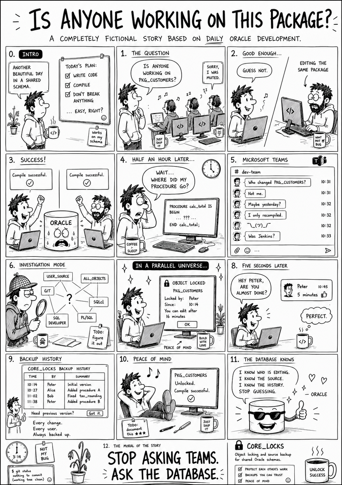

# CORE_LOCKS

## Object locking and source backup for shared Oracle schemas – standalone, no framework required

<br>
<p></p>

<br>

## Table of Contents

1. [Project Overview](#1-project-overview)
2. [How It Works](#2-how-it-works)
3. [APEX](#3-apex)
4. [API Reference](#4-api-reference)
5. [Configuration](#5-configuration)
6. [Operational Notes](#6-operational-notes)
7. [Installation & Setup](#7-installation--setup)
8. [Proxy Users & Startup Script](#8-proxy-users--startup-script)
9. [Tests](#9-tests)

<br>

## 1. Project Overview

Two developers, one dev schema, one package, and the last compile wins. Nobody gets a warning; the colleague's work is simply gone. CORE_LOCKS locks every object the moment somebody compiles it, and refuses the compile when somebody else holds it.

- **Nothing to call.** A DDL trigger takes the lock on every `CREATE`, `ALTER` and `DROP`.
- **Every compile is a backup.** Each lock row keeps the source that was compiled.
- **APEX too.** Builder compiles are tracked as they are, and you can lock an application or a single page.
- **Five objects, no framework.** One table, one package, one trigger, two jobs. Extracted from [CORE23](https://github.com/jkvetina/CORE23), without its `CORE` and `CORE_CUSTOM` packages.

<br>

## 2. How It Works

### Two developers, one package

ALICE compiles a package. She does nothing special, the trigger takes the lock for her:

```sql
CREATE OR REPLACE PACKAGE orders_api AS
    PROCEDURE ship_order (in_order_id NUMBER);
END;
/
```

```text
Package created.
```

While her lock is live, BOB compiles his own version of the same package:

```sql
CREATE OR REPLACE PACKAGE orders_api AS
    PROCEDURE ship_order (in_order_id NUMBER, in_carrier VARCHAR2);
END;
/
```

```text
ORA-04088: error during execution of trigger 'CORE_LOCKS.CORE_LOCKSMITH'
ORA-00604: Error occurred at recursive SQL level 1. Check subsequent errors.
ORA-20990: LOCK_TIME_ERROR: OBJECT_LOCKED_BY `ALICE` [22513]
```

- `ALICE` holds the package, so BOB knows who to call.
- `22513` is her lock row, with her source in it.
- BOB's compile is refused, and the package in the database is still ALICE's version.
- The lock runs 20 minutes from her last compile, and every compile she makes pushes it out again.

<br>

### Every compile is a backup

ALICE adds a procedure and compiles again. Same lock, refreshed:

```sql
SELECT t.lock_id, t.object_name, t.locked_by, t.locked_at, t.expire_at, t.counter
FROM core_locks t
ORDER BY t.lock_id;
```

```text
   LOCK_ID OBJECT_NAME  LOCKED_BY  LOCKED_AT        EXPIRE_AT           COUNTER
---------- ------------ ---------- ---------------- ---------------- ----------
     22513 ORDERS_API   ALICE      2026-10-25 17:48 2026-10-25 18:08          2
```

The row holds the source of her last compile:

```sql
SELECT t.object_payload
FROM core_locks t
WHERE t.lock_id = 22513;
```

```text
CREATE OR REPLACE PACKAGE orders_api AS
    PROCEDURE ship_order (in_order_id NUMBER);
    PROCEDURE cancel_order (in_order_id NUMBER);
END;
```

- **One row per 10 minutes of work.** Compiles inside 10 minutes refresh the same row, a later one closes it and starts a new one, so the table keeps a version of the object as you go.
- **A `DROP` is backed up too.** Its row carries the source of what was dropped, so the last copy of a dropped package is still here.
- **`ALTER ... COMPILE` is skipped.** Recompiling is not a change.
- **Seven days in full.** After that the `CORE_LOCKS_PURGE` job keeps one row per object (owner, time and the SHA-256 hash of the source) and drops the source text.

<br>

### Take over a lock

ALICE is done and releases the package (or her 20 minutes run out):

```sql
BEGIN
    core_lock.unlock(
        in_object_name      => 'ORDERS_API'
    );
END;
/
```

BOB compiles the package as it is in the database, and this time it goes through:

```text
   LOCK_ID OBJECT_NAME  LOCKED_BY  LOCKED_AT        EXPIRE_AT           COUNTER
---------- ------------ ---------- ---------------- ---------------- ----------
     22513 ORDERS_API   ALICE      2026-10-25 17:48                           2
     22514 ORDERS_API   BOB        2026-10-25 17:48 2026-10-25 18:08          1
```

When you take an object over from somebody else, compile it once **unchanged** first. That proves your copy matches what is in the database, and only then make your edits.

Who holds what right now:

```sql
SELECT t.locked_by, t.object_type, t.object_name, t.expire_at
FROM core_locks t
WHERE t.expire_at >= SYSDATE
ORDER BY t.locked_by, t.object_name;
```

```text
LOCKED_BY  OBJECT_TYPE  OBJECT_NAME  EXPIRE_AT
---------- ------------ ------------ ----------------
BOB        PACKAGE      ORDERS_API   2026-10-25 18:08
```

<br>

### What the trigger decides

`core_locksmith` fires `AFTER DDL ON SCHEMA` for `CREATE`, `ALTER` and `DROP` on tables, views, materialized views, packages, package bodies, procedures, functions and triggers. It ignores `DEPSCAN$%` and anything named `CORE_LOCK%`, so the feature cannot lock itself out.

| Situation | Outcome |
| --- | --- |
| No lock on the object | new row, the compile goes through |
| Same user holds the lock | lock extended, source and hash refreshed |
| Different user, lock still live | `LOCK_TIME_ERROR: OBJECT_LOCKED_BY ...`, the compile is refused |
| Different user, lock no longer live, cut less than a minute ago, and the source hash differs | `LOCK_HASH_ERROR: OBJECT_CHANGED_BY ...`, the compile is refused |
| Lock older than the rebook window | current row closed, new row inserted as a fresh backup point |
| Session names nobody | `USER_ERROR: USE_PROXY_USER_OR_SET_CLIENT_ID`, the compile is refused |

- **The hash skips the `CREATE ... AS` header,** the one part nobody writes the same way twice. That is what lets a lock booked by hand and a lock taken by a compile fingerprint the same object identically.
- **The trigger hashes the statement it was handed,** never the dictionary: inside an `AFTER DDL` trigger the compile has not committed yet, so the dictionary still holds the previous version.
- **A materialized view** arrives as `SNAPSHOT` and is recorded as `MATERIALIZED VIEW`, the name `DBMS_METADATA` uses, so a compile and a hand lock find each other in the history.

<br>

## 3. APEX

### Builder compiles are tracked as they are

- **Nothing to set up.** A package saved in the Object Browser or SQL Workshop goes through the same trigger as one compiled in your editor.
- **The lock carries your Builder name.** APEX stamps the session as `JAN:12345678`, and the session number is dropped, so the row says `JAN`.
- **Use the same name in your editor** ([Proxy Users & Startup Script](#8-proxy-users--startup-script)), and a package you start in the browser and finish in SQL Developer stays one lock held by one person.

<br>

### Lock an application or a page

ALICE locks the whole application for a deploy:

```sql
BEGIN
    core_lock.create_lock(
        in_app_id           => 9901,
        in_comment          => 'Deploy 4711'
    );
END;
/

SELECT core_lock.get_lock(in_app_id => 9901) AS app_owner FROM dual;
```

```text
APP_OWNER
--------------------------------------------------------------------------------
ALICE
```

BOB wants to rework one page of it:

```sql
BEGIN
    core_lock.create_lock(
        in_app_id           => 9901,
        in_page_id          => 1,
        in_comment          => 'Reworking the grid'
    );
END;
/
```

```text
ORA-20990: APP_LOCK_ERROR: APP_LOCKED_BY `ALICE` [9901]
```

ALICE finishes the deploy and unlocks, BOB takes the page, and now ALICE is the one refused on it:

```sql
BEGIN
    core_lock.unlock(
        in_app_id           => 9901
    );
END;
/
```

```text
APP 9901 UNLOCKED
ORA-20990: PAGE_LOCK_ERROR: PAGE_LOCKED_BY `BOB` [9901:1]
```

The locks are the ones the Builder shows, under the same name a DDL lock carries.

- **The application lock wins.** A page inside an application somebody else holds is refused.
- **One name, one owner.** APEX compares application lock owners case-insensitively and page lock owners case-sensitively, so every name goes through `clean_user` and is uppercased.
- **Unlock only releases your own lock.** APEX's own unlock with a NULL user frees anybody's, so a failed deploy would free a colleague's application; `unlock` never does that.
- **An import keeps the application lock and drops every page lock.** Call `get_lock` before a deploy, and check `apex_application_locked_pages` for whose page work the import is about to unlock.
- **Pass `in_locked_by`** to lock for somebody else, a deploy account for example.
- **Call page locks from a script or SQL**, not from inside a running page request. They go through the package Page Designer uses, which resets the OWA context and the HTP buffer.
- **Both commit on their own**, so the Builder and other sessions see the lock straight away.

| Message | Meaning |
| --- | --- |
| ``APP_LOCK_ERROR: APP_LOCKED_BY `ALICE` [100]`` | somebody else holds the application |
| ``PAGE_LOCK_ERROR: PAGE_LOCKED_BY `BOB` [100:10]`` | somebody else holds the page |
| ``USER_ERROR: NOT_A_WORKSPACE_DEVELOPER `CI` `` | APEX locks applications only for developers of that workspace |
| `USER_ERROR: GRANT_WWV_FLOW_PROPERTY_DEV` | page locks need the grant from [Installation & Setup](#7-installation--setup) |
| `APEX_VERSION_ERROR: LOCK_APP_NEEDS_APEX_26_2` | there is no application lock API before APEX 26.2 |
| `APP_ERROR: APP_NOT_FOUND [100]` | the schema cannot see that application |
| `PAGE_LOCK_ERROR: PAGE_NOT_LOCKED [100:10]` | APEX did not lock the page, a page that does not exist for example |

<br>

## 4. API Reference

Every procedure that writes runs as an autonomous transaction and commits on its own; it has to, since a DDL trigger drives it.

<br>

### Create lock

`create_lock` is what the trigger calls on every compile, and it takes a lock by hand just as well: to hold an object before a deploy, or to book one before you start editing it.

```sql
BEGIN
    core_lock.create_lock(
        in_object_owner     => 'APPS',
        in_object_type      => 'PACKAGE BODY',
        in_object_name      => 'MY_PACKAGE',
        in_locked_by        => NULL,     -- defaults to get_user()
        in_expire_at        => NULL,     -- defaults to now + g_lock_length
        in_hash_check       => TRUE
    );
END;
/
```

- **Called by hand, the backup comes from the dictionary.** `user_source` for packages, package bodies, procedures, functions and triggers, `user_views` for a view, `DBMS_METADATA.GET_DDL` for anything else, a table being the usual one.
- **An object the dictionary has nothing for is still locked,** just without a backup.
- **A hand lock and a compile lock fingerprint the same object identically.** The dictionary quotes and qualifies the name, adds `EDITIONABLE` and prints a view's column list, so the hash is taken without the header.
- **`GET_DDL` reprints, it does not repeat.** Asked for a `PACKAGE` it returns the spec and the body, asked for a `TRIGGER` it appends `ALTER TRIGGER ... ENABLE`, which is why the dictionary's own source columns are read first.

<br>

### Unlock

`unlock` releases locks and reports each one through `DBMS_OUTPUT`. Pass at least one of `in_lock_id`, `in_locked_by` or `in_object_name`, otherwise it raises `ARGUMENTS_MISSING`.

```sql
BEGIN
    core_lock.unlock(
        in_object_name      => 'MY_PACKAGE'     -- free one object
    );
    --
    core_lock.unlock(
        in_locked_by        => 'JAN'            -- free everything a user holds
    );
END;
/
```

<br>

### Extend lock

`extend_lock` pushes the expiry out and refreshes the stored source and hash. Pass a number of days, or an explicit date.

```sql
BEGIN
    core_lock.extend_lock(
        in_lock_id          => 10001,
        in_time             => 60/1440          -- +60 minutes
    );
    --
    core_lock.extend_lock(
        in_lock_id          => 10001,
        in_expire_at        => SYSDATE + 1
    );
END;
/
```

<br>

### Application and page locks

The APEX overloads, shown in action in [APEX](#3-apex):

```sql
BEGIN
    core_lock.create_lock(
        in_app_id           => 100,
        in_page_id          => 10,              -- leave out for the whole application
        in_locked_by        => NULL,            -- defaults to get_user()
        in_comment          => 'Reworking the grid'
    );
    --
    core_lock.unlock(
        in_app_id           => 100,
        in_page_id          => 10
    );
END;
/

SELECT core_lock.get_lock(in_app_id => 100, in_page_id => 10) AS owner FROM dual;   -- NULL when free
```

<br>

### Purge

`purge_locks` is the retention rule, run daily at 03:00 by the `CORE_LOCKS_PURGE` job, and safe to run by hand. It reports its row counts through `DBMS_OUTPUT`.

```sql
BEGIN
    core_lock.purge_locks();
END;
/
```

- Rows younger than `g_purge_after` (7 days) are never touched, and neither is a live lock.
- Older history collapses to the newest row per object, which keeps the hash, owner and timestamps but loses its `object_payload`.

<br>

### Raise error

`raise_error` raises `ORA-20990` carrying the message, with `keeperrorstack` on. It is public because the trigger calls it from its own `WHEN OTHERS`. `core_lock.app_exception` is pinned to the same code CORE23 and CORE_LOGS use, so one APEX error handler recognizes all of them.

<br>

### Helpers

Exposed for diagnostics:

- **`get_user()`** returns the name the next lock row will carry, see [where it comes from](#where-the-name-comes-from).
- **`clean_user(in_name)`** strips a trailing session number, uppercases the rest, and returns NULL for a bare number or a pool account.
- **`recover_user()`** returns the name this workstation compiled under last time.
- **`get_object(in_object_type, in_object_name)`** returns the normalized DDL a lock row would store. Called by hand it reads the dictionary, so pass the type and the name: `core_lock.get_object('PACKAGE BODY', 'MY_PACKAGE')`.
- **`get_audit_trail()`** returns the address, host, time zone and module of the current session, the string every lock row keeps in `audit_trail`.
- **`get_clob_hash(in_payload)`** returns the SHA-256 of a CLOB as hex.

`clean_user` is the same rule the lock rows are written with, so you can point it at history inherited from an older install:

```sql
SELECT DISTINCT
    t.locked_by,
    core_lock.clean_user(t.locked_by) AS person
FROM core_locks t
ORDER BY 1;
```

```sql
UPDATE core_locks t
SET t.locked_by     = core_lock.clean_user(t.locked_by)
WHERE core_lock.clean_user(t.locked_by) IS NOT NULL;
```

Keep the `IS NOT NULL` guard: `locked_by` is mandatory, and an owner that was only ever a number has nothing to clean down to.

<br>

## 5. Configuration

Constants at the top of the package body:

| Constant | Default | Meaning |
| --- | --- | --- |
| `g_lock_length` | 20 minutes | how long a lock stays live after a compile |
| `g_lock_rebook` | 10 minutes | age past which a compile cuts a new backup row instead of extending |
| `g_check_hash` | `TRUE` | master switch for the source hash comparison |
| `g_purge_after` | 7 days | history younger than this is never purged |
| `c_anon_users` | pool and process accounts | names `clean_user` refuses, colon delimited |

Lock numbering starts at 10000, assigned by the identity column on `core_locks.lock_id`.

<br>

## 6. Operational Notes

- **The trigger can block every DDL in the schema.** A bug in `core_lock`, a missing `DBMS_CRYPTO` grant or a session with no name fails all DDL, including the DDL that would fix it. Install it on a dev schema first.
- **Disabling the trigger is not enough.** `CORE_LOCKSMITH_ENABLE` switches it back on every five minutes, so it cannot be quietly left off. To stop the feature, drop the job too:

```sql
BEGIN
    DBMS_SCHEDULER.DROP_JOB('CORE_LOCKSMITH_ENABLE', TRUE);
    EXECUTE IMMEDIATE 'ALTER TRIGGER core_locksmith DISABLE';
END;
/
```

- **It changes the day of everyone on the schema,** every developer and every pipeline. Install it as a team decision.
- **The purge job caps the table.** The last 7 days stay as they are, older history collapses to one hash-only row per object, live locks are never touched.
- **Freed space is reused, not returned.** After the first purge of a large backlog, hand it back once:

```sql
ALTER TABLE core_locks ENABLE ROW MOVEMENT;
ALTER TABLE core_locks SHRINK SPACE CASCADE;
ALTER TABLE core_locks DISABLE ROW MOVEMENT;
```

<br>

## 7. Installation & Setup

### Requirements

- Oracle Database 23ai or later, Oracle Database Free included (`CREATE TABLE IF NOT EXISTS`, identity columns).
- APEX installed, because `get_object` uses `APEX_STRING`.
- Two grants from `SYS`:

```sql
GRANT EXECUTE ON dbms_crypto TO <schema>;      -- SHA-256 source hashing
GRANT EXECUTE ON dbms_scheduler TO <schema>;   -- the locksmith enable job
```

- Application locks need APEX 26.2 or newer; on older versions they raise `APEX_VERSION_ERROR` and everything else works.
- Page locks need one more grant from `SYS`, and only if you use them:

```sql
GRANT EXECUTE ON <APEX schema>.wwv_flow_property_dev TO <schema>;
```

<br>

### Install

Run these in this order, since the package body needs the table and the trigger needs the package:

```text
database/tables/core_locks.sql
database/packages/core_lock.spec.sql
database/packages/core_lock.sql
database/triggers/core_locksmith.sql
database/jobs/core_locksmith_enable.sql
database/jobs/core_locks_purge.sql
```

Both jobs are optional but recommended, see [Operational Notes](#6-operational-notes).

<br>

### Check it works

1) Put a name on your session, see [Proxy Users & Startup Script](#8-proxy-users--startup-script).
2) Compile any package in the schema.
3) Find your lock:

```sql
SELECT t.lock_id, t.object_name, t.locked_by, t.expire_at
FROM core_locks t
ORDER BY t.lock_id DESC
FETCH FIRST 1 ROW ONLY;
```

Then ask a colleague to compile the same package.

<br>

## 8. Proxy Users & Startup Script

A lock is only useful when you know who to call. Pick one of these two for the whole team.

<br>

### Proxy users (recommended)

Each developer gets a personal login and connects through it to the shared schema. Nobody needs the schema password.

1) As a DBA, once per developer:

```sql
CREATE USER jan IDENTIFIED BY "SomeStrongPassword#1";
GRANT CREATE SESSION TO jan;

ALTER USER apps GRANT CONNECT THROUGH jan;
```

2) The developer connects as `jan[apps]` with their own password. In SQL Developer the same string goes into the username field.

```sql
CONNECT jan[apps]/"SomeStrongPassword#1"@dev_db
```

3) Taking the access away is one statement:

```sql
ALTER USER apps REVOKE CONNECT THROUGH jan;
```

The session runs as `apps` with all its privileges, and the lock rows say `JAN`. Nothing to run after connecting.

<br>

### Startup script

No DBA willing to create users? Then each session names itself:

```sql
BEGIN
    DBMS_SESSION.SET_IDENTIFIER('JAN');
END;
/
```

- **Use the name you have in the APEX Builder.** `JAN` in the browser and `JKVETINA` in SQL Developer are two colleagues who keep locking each other out, and both of them are you.
- **Run it on every connect,** since the identifier is gone after a reconnect:
	- SQL Developer: Tools, Preferences, Database, "Filename for connection startup script".
	- SQLcl and SQL\*Plus: `login.sql`, read from `SQLPATH` or `ORACLE_PATH`.
	- Other tools: their logon or post-connect script hook.

<br>

### Check your name

```sql
SELECT core_lock.get_user() AS me FROM dual;
```

```text
ME
--------------------------------------------------------------------------------
BOB
```

- **A name** is what your colleagues will see in `OBJECT_LOCKED_BY`.
- **An IP address** means nothing named your session and the fallback took over, so your colleagues would see ``OBJECT_LOCKED_BY `10.20.30.44` ``. Go back to one of the two options above.
- **NULL** means your next compile is refused with `USER_ERROR: USE_PROXY_USER_OR_SET_CLIENT_ID`.

Run it again after `APEX_SESSION.ATTACH`. It should still be your name.

<br>

### Where the name comes from

`get_user` takes the first of these that names a person:

| Order | Source | Where it comes from |
| --- | --- | --- |
| 1 | `PROXY_USER` | the database authenticated the person, nothing beats that |
| 2 | `CLIENT_IDENTIFIER` | your startup script or APEX, as long as nothing overwrote it |
| 3 | `recover_user` | who this same workstation compiled as last time, asked when the identifier is a context key or a bare number |
| 4 | `APEX$SESSION.APP_USER` | the application user, a company account behind an SSO login |
| 5 | `CLIENT_IDENTIFIER` again | the name left inside a context key, once the key part is stripped |
| 6 | `CLIENT_INFO` | the same idea, minus any prefix a job put in front of it |
| 7 | `OS_USER` | your desktop login, for an editor you never configured |
| 8 | `IP_ADDRESS` | not a person, but traceable |

- **Every name is uppercased,** so `Jan`, `JAN` and `jan` are one developer.
- **`clean_user` filters every candidate.** It strips a trailing session number (`JAN:12345678` and `JAN_100_12345678901234` both become `JAN`) and drops anything that is only digits or names a pool account (`ORDS_PUBLIC_USER`, `ANONYMOUS`).
- **An attached APEX session keeps your name.** `APEX_SESSION.ATTACH` overwrites the identifier with whatever the application's context code puts there. `recover_user` then reads the `audit_trail` history (address and host of the workstation) and finds the name this machine compiled under last time.
- **The recovery only repairs, it never invents.** It runs only when the identifier names nobody. A session with no identifier at all falls through to the OS user and the IP address.
- **Attaching a colleague's session on a machine with no history makes you them.** Detach when you are done:

```sql
BEGIN
    APEX_SESSION.DETACH();
END;
/
```

- **A shared host (Citrix, NAT) shares one IP address** and one history, so the fallback cannot tell people apart. Give those people proxy users.
- **A local connection on the database server and a scheduler job have no address** and run as the database's own OS account, so they are refused.

<br>

## 9. Tests

- 101 utPLSQL tests in six suites cover every public routine, every optional argument, and the trigger across all three events and every tracked object type.
- Separate connections test a proxy user and a session with no address, since neither can be faked from inside one session.
- Mutation sweeps broke the code on purpose, and every break was caught.
- GitHub Actions runs everything on every push and pull request.

How the suites are built, why they need three connections, coverage and CI: [docs/tests.md](docs/tests.md).
